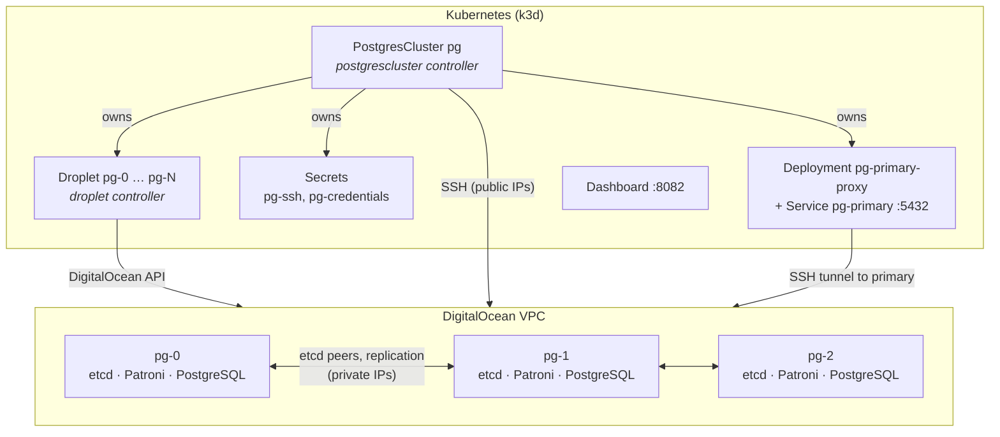

# operator

A Kubernetes operator that runs **highly available PostgreSQL on DigitalOcean**.
Apply one `PostgresCluster` object and the operator creates the Droplets, installs
**etcd**, **Patroni** and **PostgreSQL** on each of them, bootstraps the cluster,
and keeps reporting which member is the primary.

```yaml
apiVersion: webapp.ferh6t.github.io/v1
kind: PostgresCluster
metadata:
  name: pg
spec:
  replicas: 3
  postgresVersion: "16"
  droplet:
    region: fra1
    size: s-1vcpu-2gb-intel
    image: ubuntu-24-04-x64
    tokenSecretRef:
      name: digitalocean-token
```

```console
$ kubectl get pgc
NAME   MEMBERS   READY   PRIMARY   VERSION   PHASE     AGE
pg     3         3       pg-0      16        Running   6m
```

## Features

- **One object, whole cluster.** Droplets, SSH key, passwords, etcd cluster, Patroni and PostgreSQL are all created from a `PostgresCluster`.
- **Automatic failover.** Patroni elects a new primary through etcd when the primary dies.
- **Self-healing members.** A destroyed Droplet is recreated, swapped into etcd and cloned from the current primary.
- **Scaling.** `make scale REPLICAS=5` adds or removes members one at a time without losing quorum or the primary.
- **Planned switchover.** `make switchover CANDIDATE=pg-2` moves the primary safely.
- **Truthful health.** Every member's PostgreSQL role, state, replication lag, timeline and etcd health in `status`, refreshed every 30 seconds.
- **Live dashboard** on http://localhost:8082.
- **Connect from your laptop** with `make db-forward`, without opening PostgreSQL to the internet.

## Architecture



Two controllers share the work:

| Controller | Watches | Does |
|---|---|---|
| `droplet` | `Droplet` | Creates, tracks and deletes one real DigitalOcean server. A finalizer makes sure the server is deleted when the object is. |
| `postgrescluster` | `PostgresCluster` | Creates its `Droplet`s, then installs and configures every member over SSH, manages etcd membership, starts Patroni and reports health. |

Every member runs all three components. The etcd members form one cluster; Patroni
uses it to hold the leader lock, so exactly one member accepts writes and the others
stream from it.

### How a cluster comes up

Each reconcile re-checks every step and continues from the first unfinished one.

| Phase | What happens |
|---|---|
| `Provisioning` | Generate `<name>-ssh` (ed25519 key) and `<name>-credentials` (passwords). Create the Droplets; cloud-init adds the controller's public key. Wait until all are active with public and private IPs. |
| `Installing` | Over SSH, install `postgresql-<version>`, `patroni`, `etcd` from the PostgreSQL apt repository. Long steps run on the Droplet as a `systemd-run` unit, so a reconcile never blocks for minutes. |
| `Bootstrapping` | Write `/etc/default/etcd` and `/etc/patroni/config.yml` with every member's private IP, start etcd, wait for etcd quorum, start Patroni. The first member to take the leader lock runs `initdb`; the others clone it. |
| `Running` | Every member is running and every etcd member is healthy. Health is checked every 30 seconds. |
| `Scaling` | `spec.replicas` changed; members are being added or removed. The database keeps serving. |
| `Degraded` | Something is wrong after the cluster has run; the `Available` and `Degraded` conditions say what. |

## Quick start

### Prerequisites

- Docker, [k3d](https://k3d.io), `kubectl`, Go 1.26+
- `jq` and `envsubst` (`brew install jq gettext`)
- A DigitalOcean account and an [API token](https://cloud.digitalocean.com/account/api/tokens)

### 1. Create a local cluster

```sh
k3d cluster create --config cluster/cluster.yml
```

This maps the dashboard to `localhost:8082`.

### 2. Configure DigitalOcean access

```sh
cp .env.example .env
# edit .env: set DO_TOKEN, and optionally DO_SSH_KEYS with your own key fingerprints
```

`.env` is git-ignored. `DO_SSH_KEYS` is only for logging in yourself; the operator uses its own generated key.

### 3. Build and deploy the operator

```sh
export IMG=operator:dev1
make docker-build IMG=$IMG
k3d image import $IMG -c operator
make deploy IMG=$IMG
kubectl -n operator-system rollout status deploy/operator-controller-manager
```

Use a new tag for every build (`dev2`, `dev3`, …). With `:latest` Kubernetes tries to pull from a registry,
and with a reused tag the pod keeps the old image.

### 4. Create a PostgreSQL cluster

```sh
make apply-postgrescluster-sample
kubectl get pgc pg -w
```

The cluster reaches `Running` about 5 minutes after the Droplets boot. Open http://localhost:8082 to watch it.

### 5. Connect

```sh
make db-forward          # keep it running
```

In another terminal:

```sh
kubectl get secret pg-credentials -o jsonpath='{.data.password}' | base64 -d | pbcopy
psql "host=localhost port=15432 user=postgres dbname=postgres"
```

In **pgAdmin**, register a server with host `localhost` (or `127.0.0.1`), port `15432`,
database `postgres`, user `postgres`, and the password above. No SSH tunnel settings are needed.

## Operations

| Task | Command |
|---|---|
| Watch a cluster | `kubectl get pgc pg -w`, or http://localhost:8082 |
| Scale to 5 members | `make scale REPLICAS=5` (or `kubectl scale pgc pg --replicas=5`) |
| Move the primary | `make switchover CANDIDATE=pg-2` (omit `CANDIDATE` to let Patroni pick) |
| Show members without changing anything | `make switchover CHECK_ONLY=1` |
| Connect from your laptop | `make db-forward` (`PORT=` to change the local port) |
| Get the password | `kubectl get secret pg-credentials -o jsonpath='{.data.password}' \| base64 -d` |
| Log in to a member | `kubectl get secret pg-ssh -o jsonpath='{.data.ssh-privatekey}' \| base64 -d > ~/.ssh/pg && chmod 600 ~/.ssh/pg`, then `ssh -i ~/.ssh/pg root@<public IP>` |
| Delete everything and start over | `make undeploypg` |

All targets take `CLUSTER=` (default `pg`) and `NAMESPACE=` (default `default`).

### Scaling

`replicas` must be odd (1, 3, 5 or 7) so etcd always has a clear majority. Scale only a `Running` cluster.

- **Up:** new Droplets are created and installed, then added to etcd **one at a time**; each joins
  the running etcd cluster and is cloned by Patroni from the primary.
- **Down:** members leave **highest number first**, one per reconcile. If the member is the primary,
  Patroni first hands over to the most caught-up replica. The member is removed from etcd only if
  the rest keep a quorum, then its Droplet is deleted.

### Failover and replaced members

If the primary dies, Patroni promotes a replica within about 30 seconds; the status, the dashboard and
the `pg-primary` proxy follow it. If a Droplet is destroyed, the Droplet controller creates a new server
under the same name. The cluster controller removes the dead etcd member, adds the new one, configures it
to join, and Patroni clones it from the primary.

A 3-member cluster survives **one** lost member at a time. Losing two before the first is back
loses etcd quorum: Patroni then cannot elect a primary, and the status says `EtcdQuorumLost`.
Recover by restarting etcd on a surviving member with `--force-new-cluster`; the controller then adds the
others back one at a time.

### Tearing down

```sh
make undeploypg
```

Deletes every `PostgresCluster` and `Droplet`, **waits until their DigitalOcean servers are gone**, then
undeploys the operator. Prefer it over `make undeploy`: the Droplet finalizers need the running controller
to delete the servers, so removing the controller first leaves servers running and billed.

## API reference

### PostgresCluster (`pgc`)

| Spec field | Default | Notes |
|---|---|---|
| `replicas` | `3` | Odd, 1–7. Changing it scales the cluster. |
| `postgresVersion` | `"16"` | `14`, `15`, `16` or `17`. Immutable. |
| `droplet` | required | Same fields as a `Droplet` spec. `name` and `userData` are ignored. The image must be `ubuntu-24-04-x64`. |
| `allowedSourceRanges` | `10.0.0.0/8` | CIDRs allowed to log in with a password. Members always reach each other. |

| Status field | Meaning |
|---|---|
| `phase` | `Provisioning`, `Installing`, `Bootstrapping`, `Running`, `Scaling` or `Degraded` |
| `primary` | Member that accepts writes |
| `readyMembers` | Members whose PostgreSQL is running |
| `members[]` | Per member: public and private IP, role, state, lag in bytes, timeline, etcd health, pinned SSH host key |
| `lastHealthCheck` | When etcd and Patroni were last asked |
| `credentialsSecret`, `sshSecret` | Names of the generated Secrets |
| `conditions` | `Available`, `Progressing`, `Degraded`, `Initialized` |

Objects the operator creates for a cluster `pg`, all owned by it and deleted with it:

| Object | Purpose |
|---|---|
| `Droplet` `pg-0` … `pg-N` | The servers |
| `Secret` `pg-ssh` | The controller's SSH key (`kubernetes.io/ssh-auth`) |
| `Secret` `pg-credentials` | `username`, `password`, `replication-password` |
| `Deployment` `pg-primary-proxy` | SSH tunnel to the current primary |
| `Service` `pg-primary` | Port 5432 of the primary, for clients in the cluster and `make db-forward` |

### Droplet (`do`)

One DigitalOcean server. Field names follow the [DigitalOcean API](https://docs.digitalocean.com/reference/api/api-reference/#operation/droplets_create):
`region`, `size`, `image`, `sshKeys`, `backups`, `ipv6`, `monitoring`, `vpcUUID`, `userData`, `tags`,
`volumes`, and `tokenSecretRef` (the Secret holding the API token). Its status carries the server ID,
state and addresses; a `<name>-info` ConfigMap holds the same for other apps.

## Dashboard

The controller serves a dashboard on port 8082 (`--ui-bind-address`, `0` to disable). With the k3d config
above it is at http://localhost:8082. It shows every cluster's phase, primary, etcd health and last
health check, a table of members with role, PostgreSQL state, etcd health, lag and timeline, all
conditions, every Droplet, and recent reconciles. It never shows passwords or keys.

## Security

- **SSH:** the controller generates its own ed25519 key per cluster and installs it through cloud-init.
  On first connect it pins each server's host key fingerprint; a different key later is refused
  (`HostKeyMismatch`). `make switchover` and the primary proxy check the same pin.
- **Passwords** are generated once and never rotated by the operator.
- **Network:** etcd (2379, 2380) and the Patroni API (8008) listen only on private IPs. PostgreSQL listens
  on all interfaces, but `pg_hba` only accepts password logins from `allowedSourceRanges` and the members.
  `make db-forward` goes through an SSH tunnel, so no public access is needed.
- **Not encrypted yet:** etcd, Patroni and replication traffic inside the VPC, and PostgreSQL client
  connections. A DigitalOcean cloud firewall for the cluster's tag is recommended.

## Limitations

- Ubuntu 24.04 Droplets only.
- No TLS between components or for clients.
- `postgresVersion` cannot be upgraded in place.
- Losing a majority of members at once needs a manual etcd recovery (see above).
- No backups or point-in-time recovery yet.
- The proxy pod installs the SSH client from Alpine's package mirror when it starts, so the Kubernetes
  cluster needs internet access.

## Development

```sh
make test          # unit tests and envtest controller tests
make manifests     # regenerate CRDs and RBAC after changing markers
make generate      # regenerate DeepCopy code after changing types
make run           # run the controller against your current kubeconfig (stop the in-cluster one first)
```

Controller tests replace SSH with a fake executor, so they need neither DigitalOcean nor real servers.

```
api/v1/                     PostgresCluster and Droplet types
cmd/main.go                 manager entry point
internal/controller/        droplet and postgrescluster controllers, primary proxy
internal/postgres/          install and config scripts, SSH runner, etcd and Patroni helpers
internal/digitalocean/      DigitalOcean API calls
internal/ui/                dashboard
hack/switchover.sh          make switchover
cluster/cluster.yml         k3d cluster with the dashboard port
config/                     Kustomize manifests (CRDs and RBAC are generated)
```

This is a [Kubebuilder](https://book.kubebuilder.io) project; see `AGENTS.md` for the conventions.

## Troubleshooting

| Symptom | Cause and fix |
|---|---|
| `kubectl`: connection refused to `0.0.0.0:<port>` | The k3d load balancer stopped. `docker start k3d-operator-serverlb`. |
| `k3d cluster edit --port-add 8082…`: address already in use | The port is already mapped. Run it only once per cluster. |
| `k3d image import`: image is not a file | The image was never built. Run `make docker-build IMG=$IMG` first. |
| Cluster has no phase; controller logs `no matches for kind` | An old controller image is deployed. Deploy the current one with a new tag. |
| DigitalOcean 422 `Size is not available in this region` | Pick a size the region offers, e.g. `s-1vcpu-2gb-intel` in `fra1`. |
| pgAdmin: connection refused on `localhost:15432` | `make db-forward` is not running, or an old one listens on IPv4 only; restart it or use `127.0.0.1`. |
| pgAdmin: password authentication failed on port 5432 | Port 5432 on your Mac may be another PostgreSQL. Use port `15432`. |
| Phase `Degraded` with `EtcdQuorumLost` | More than half of the etcd members are gone; see [Failover and replaced members](#failover-and-replaced-members). |

## License

Copyright 2026.

Licensed under the Apache License, Version 2.0 (the "License");
you may not use this file except in compliance with the License.
You may obtain a copy of the License at

    http://www.apache.org/licenses/LICENSE-2.0

Unless required by applicable law or agreed to in writing, software
distributed under the License is distributed on an "AS IS" BASIS,
WITHOUT WARRANTIES OR CONDITIONS OF ANY KIND, either express or implied.
See the License for the specific language governing permissions and
limitations under the License.
